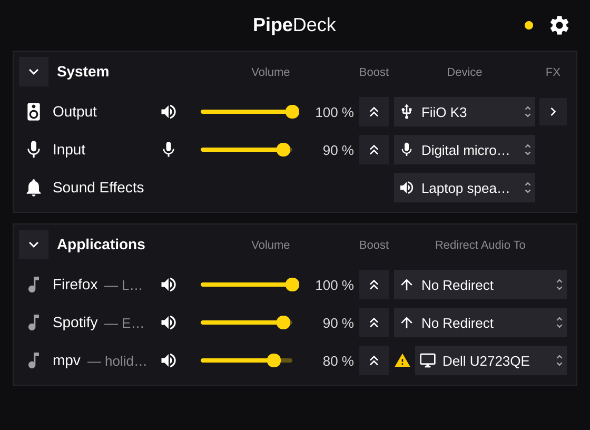
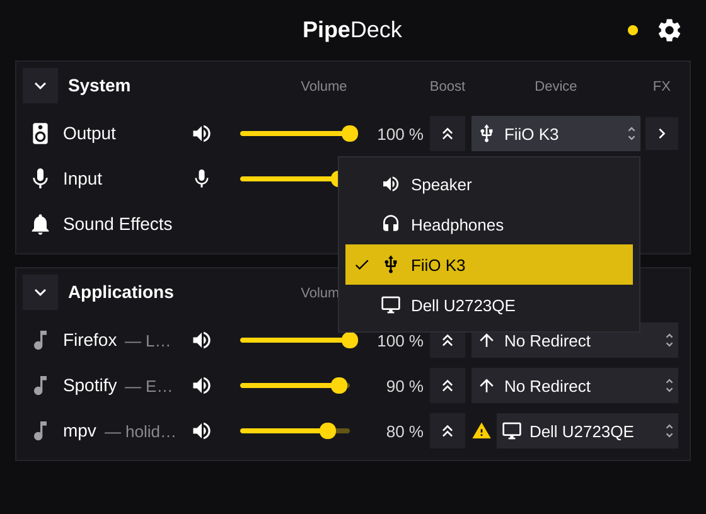
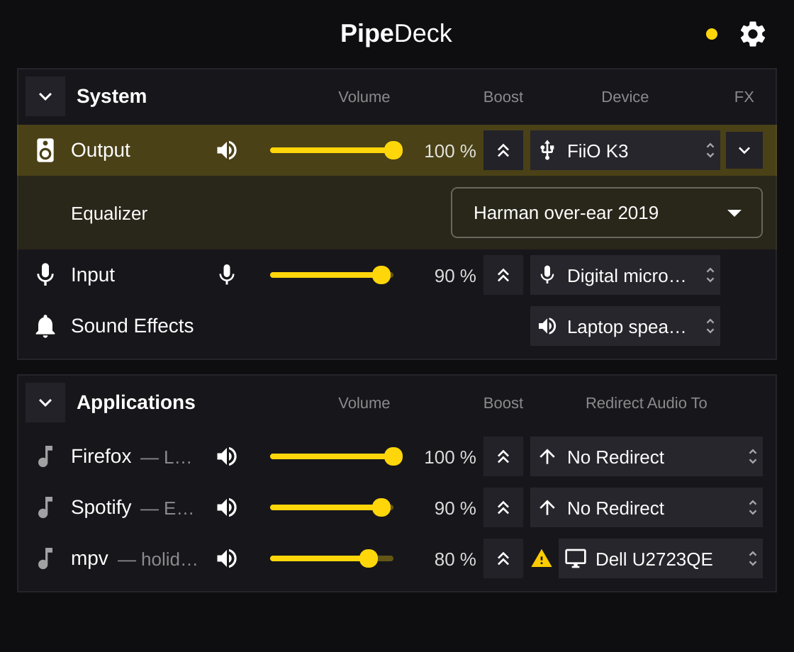

# pipedeck-ui



The PipeDeck window for Omarchy / Hyprland, laid out like Rogue Amoeba's
SoundSource: a **System** block (Output, Input, Sound Effects) and an
**Applications** block with one row per playing stream. Each row has mute, a
volume slider, Boost (that slider to 150 %) and a device menu: the output or
input device (ports flattened into places — "Speaker", "Headphones"), where
notification sounds go, or where a stream is redirected. The Output row's FX
chevron opens the EQ preset and auto-mute switch; the gear opens Settings
(port-switch cap, daemon status). It is a Qt Quick front end to `pipedeckd`
over D-Bus; the daemon does the work with or without the window open.

| Device menu | FX panel |
|---|---|
|  |  |

A ⚠ before a menu means a request the graph does not honour right now: a stream
asked for one output and plays on another, or the chosen output is unplugged.
Its tooltip says which. The contract is `../SPEC-UI.md`; the D-Bus interface
is `../crates/pipedeckd/dbus/dev.pipedeck.Daemon1.xml`.

Omarchy's own audio panel (`SUPER+CTRL+A`) stays the quick volume popup; this
window is for routing.

## Shortcuts

| Key | Does |
|---|---|
| `?` | Show or hide the shortcut overlay |
| `Q` | Quit (types a Q when a text field has focus) |
| `,` | Open or close Settings |
| `Esc` | Close the topmost: a menu, the shortcut overlay, the FX panel, Settings, then the window |
| `Tab` / `Shift+Tab` | Move between controls (the Applications list scrolls to follow) |
| `←` `→` | Change the focused slider |
| `Space` | Press the focused button or switch, or open the focused device menu |
| `↑` `↓` `Enter` | Move in an open device menu and pick |
| `F5` | Ask the daemon to re-read the audio graph |

## Build, test, install

```sh
bin/build          # -> build/pipedeck-ui (qmake6 + make, no qt6-tools needed)
bin/test           # Qt Test, offscreen, against a fake daemon on a private bus
bin/install-user   # ~/.local/bin, ~/.local/share/applications, hicolor icon
bin/install        # makepkg -fsi in ../packaging/arch: daemon, CLI and this window
```

`bin/install-user` installs only the window, to
`~/.local/bin/pipedeck-ui`, `~/.local/share/applications/pipedeck-ui.desktop`
and `~/.local/share/icons/hicolor/scalable/apps/pipedeck-ui.svg`; the daemon
and CLI come from the repository's `install.sh`. Where `sudo` asks for a
password, build the package with `makepkg -fd` in `../packaging/arch` and
install it with `pacman -U`.

If the daemon is not running the window says so and offers **Start**, which
uses D-Bus activation. To have it always running:
`systemctl --user enable --now pipedeckd`.

## Hyprland

Nothing here is installed for you. Add the keybind to
`~/.config/hypr/bindings.lua`, and if you want the window floating at the top
right, the rule under it (Omarchy 4.5's Lua helpers, as in
`/usr/share/omarchy/default/hypr/apps/*.lua`):

```lua
-- SUPER+CTRL+SHIFT+A opens PipeDeck; SUPER+CTRL+A stays Omarchy's audio panel.
o.bind("SUPER + CTRL + SHIFT + A", "PipeDeck", "pipedeck-ui")

-- Optional: floating, 12 px from the right edge, on every workspace. No size:
-- the window is 560 px wide and as tall as its content (300-720 px). Drop any
-- line you don't want.
o.window("^pipedeck-ui$", {
  float = true,
  move = { "(monitor_w-572)", 40 },
  pin = true,
})
```

Running `pipedeck-ui` while it is open brings the existing window forward
instead of opening a second one.

## Layout

```text
pipedeck-ui.pro       qmake project
bin/                  build, test, install, install-user
src/main.cpp          app setup, single instance, hands C++ to QML
src/daemon.*          hand-written dev.pipedeck.Daemon1 proxy + wire types
src/backend.*         state, refresh coalescing, owner generations, writes
src/rowmodel.*        keyed list model, updated in place
src/appicons.*        stream icons from desktop entries
src/singleinstance.*  QLockFile + QLocalServer
src/theme.*, src/translator.*   Omarchy accent, rounding and language
src/*.qml             the window
src/i18n/*.json       da, de, es, fr, nl
tests/                Qt Test suite and the fake daemon
pkgbuild/             .desktop entry and icon
```

Theme and Translator follow Omarchy's app template (Omacut / Monologue, MIT,
David Heinemeier Hansson).
